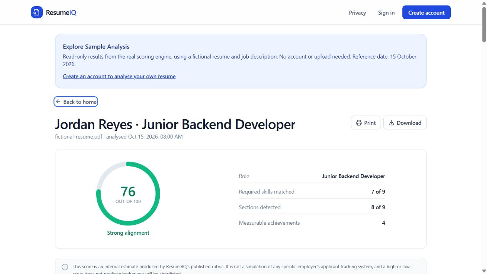
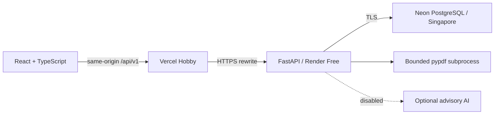

# ResumeIQ

Transparent resume and job-description comparison. Every score shows its evidence, weight and limits.

[](https://github.com/tayyab-hub/resumeiq/actions/workflows/ci.yml)
[](LICENSE)



**Live demo:** [ResumeIQ](https://resumeiq-lemon-eight.vercel.app) · [Explore the sample](https://resumeiq-lemon-eight.vercel.app/sample) · [Release evidence](docs/10-release-readiness.md). Hosted on Vercel Hobby, Render Free and Neon Free with AI disabled. The release evidence records the verified revisions and deployment status.

## Try the portfolio demonstration

Open the public [sample report](https://resumeiq-lemon-eight.vercel.app/sample), and expand a category to inspect its evidence. No account, upload or AI call is needed. This is a static export from the real engine using a fictional candidate and a fixed 15 October 2026 reference date, not a shared demo account.

For the full workflow, create a disposable account, upload [fictional-resume.pdf](docs/samples/fictional-resume.pdf), paste [fictional-job.txt](docs/samples/fictional-job.txt), and inspect the report. Refresh, visit History, download JSON, then delete the test analysis. Use fictional data for the portfolio demonstration. The API may take roughly a minute to wake after inactivity.

## Features

- Text-layer PDF extraction and required/preferred skill comparison with matching excerpts.
- Eight scoring categories, section checks and actionable statement feedback.
- Private saved reports, history, summary statistics, renaming, deletion, printing and JSON export.
- Registration, login, rotating refresh sessions, profile/password changes and account deletion.
- Complete deterministic analysis when AI is off. The intended RM0 deployment has AI explicitly disabled and no provider key.

This portfolio tool does not reproduce an employer's ATS algorithm, predict hiring, verify qualifications or assess a person's suitability for employment. “Not detected” does not mean “does not possess.”

The engineering work spans an inspectable scoring pipeline, bounded PDF processing, relational ownership and deletion, rotating sessions, browser cache isolation, PostgreSQL integration tests and a verified deployment across three services. The release evidence links these implementation choices to actual tests and their limits.

## Scoring you can inspect

| Category | Base points |
|---|---:|
| Required skill coverage | 30 |
| Experience indicators | 15 |
| Preferred skill coverage | 10 |
| Education alignment | 10 |
| Keyword coverage | 10 |
| Resume section completeness | 10 |
| Measurable achievements | 10 |
| Statement quality | 5 |

Unavailable categories score 0/0; applicable maxima rescale to exactly 100 with a deterministic rounding adjustment. The headline rounds half up. No detected statements means statement quality is unassessed, not perfect. Reports warn when job-skill evidence is insufficient. [Full methodology](docs/06-scoring-methodology.md)

## Architecture



React, Vite, Tailwind, TanStack Query and Zod provide the interface. FastAPI, Pydantic, SQLAlchemy, Alembic and PostgreSQL provide the API and persistence. Python dependencies are pinned with hashes; npm uses its lockfile. There are **nine application tables**, plus Alembic's version table. [Architecture](docs/03-architecture.md) · [Database](docs/04-database-design.md) · [API](docs/05-api-contract.md)

## Local setup

Use Python 3.12+ and Node 22. PowerShell commands:

```powershell
python -m venv .venv
.\.venv\Scripts\Activate.ps1
python -m pip install --require-hashes -r backend/requirements.txt -r backend/requirements-dev.txt
Copy-Item backend/.env.example backend/.env
cd backend
python -m alembic upgrade head
python -m uvicorn app.main:app --reload --port 8000
```

In another terminal:

```powershell
cd frontend
npm ci
npm run dev
```

Open `http://localhost:5173`. Relative `/api/v1` requests proxy to port 8000. Remove an old absolute `VITE_API_BASE_URL` override to test same-origin routing. SQLite is local-only; production refuses SQLite, debug mode, example JWT secrets and non-TLS PostgreSQL URLs.

For local seeded data only, run `python -m scripts.seed_demo` from `backend`. It creates an ordinary mutable account with public test credentials defined in the script and is blocked in production. Prefer `/sample` for recruiters.

## Verification

```powershell
# backend, with virtual environment active
ruff check app tests scripts
ruff format --check app tests scripts
pytest --cov=app/analyzers --cov=app/services --cov=app/security --cov-report=term-missing --cov-fail-under=80
python -m scripts.export_sample --check
pip-audit

# frontend
npm run typecheck
npm run lint
npm run format:check
npm test
npm run build
npm audit --audit-level=moderate

# repository root
python scripts/scan_secrets.py --history
```

On 15 October 2026, local checks measured **266 backend passes, one PostgreSQL-only skip**, **62 frontend passes**, and **91.79% coverage** of `app/analyzers`, `app/services` and `app/security`. This is not whole-application coverage. The PDF subprocess is integration-tested but not coverage-instrumented. Current PostgreSQL/container/CI results are recorded separately in [release readiness](docs/10-release-readiness.md). Python and npm audits reported no known vulnerabilities at that check; this is dated evidence, not a security guarantee.

## Privacy and security

PDF uploads may use temporary multipart storage and are closed after reading; durable PDF files are not saved. Results retain evidence excerpts, flagged statements, filename, job description and account information. Full extracted resume text requires opt-in. Application deletion does not promise immediate erasure from provider backups or operational records.

Access tokens live in browser memory. Refresh tokens use host-only HttpOnly cookies, Secure in production, SameSite=Lax, and server-side hashes with atomic rotation. Password changes invalidate previous access/refresh sessions. Logout revokes the current refresh token; a copied access token can remain valid until its 30-minute expiry. No email verification, password recovery or MFA is implemented.

Default PDF limits are 5 MB, 10 pages, 100,000 characters and 10 seconds. Linux workers also enforce a 256 MB address-space limit. One PDF worker and four mutation slots limit process pressure. Rate limits are process-local and reset on restart; forwarded IP headers are not trusted. [Security review](docs/07-security-privacy.md)

Optional AI requires explicit opt-in, a key and a model. It receives curated skill names, section keys, counts and issue codes; raw resume/job text and free-form titles/statements are excluded. Strict schema/size checks reject malformed output; failures preserve deterministic results. Advice can still be inaccurate. No paid AI calls were made for this release.

## Deployment and RM0

Verified public topology: [Vercel frontend](https://resumeiq-lemon-eight.vercel.app), [Render API health](https://resumeiq-api-zqip.onrender.com/api/v1/health), and the existing `resumeiq-prod` Neon Free database. Backend and database are in Singapore. [Deployment runbook](docs/11-deployment.md)

Verified fixed hosting cost: **RM0/month** under the inspected account conditions. Render has no card on file and showed $0 current/projected charges after deployment. Its 750 free instance hours, bandwidth and build allowance are shared with SCAMGUARD; exhaustion can suspend services or block new builds. Vercel Hobby is personal/non-commercial; Neon Free has finite compute/storage/transfer allowances. No paid add-on, domain or AI request was used. Recheck costs before adding billing or changing plans.

## Limitations

No OCR or DOCX. Complex layouts, fonts and wrapping can change extraction order. English heuristics and a curated skill catalogue miss niche roles and synonyms; related skills may receive generous partial credit. Dates, education and metrics are patterns, not verification. Live “Present” experience changes with time; the sample date is fixed. No distributed throttling or availability SLA is claimed. Live cookies, persistence across restart, isolation and deletion were tested. Shared proxy-peer login throttling can temporarily block legitimate users; old tabs may need a reload after a frontend deployment. Natural 15-minute idle wake-up is recorded separately from restart testing.

## Screenshots

Actual hosted captures include the [dashboard](docs/screenshots/dashboard-desktop.jpg), [upload form](docs/screenshots/upload-desktop.jpg), [score evidence](docs/screenshots/scoring-evidence.jpg), [skill gaps](docs/screenshots/skill-gaps-desktop.jpg), [history](docs/screenshots/history-desktop.jpg) and [mobile sample](docs/screenshots/sample-mobile.jpg). [Capture inventory](docs/screenshots/README.md)

## Future improvements

Improve date/layout extraction with a broader synthetic corpus, add verified email and account recovery, and introduce durable abuse controls if a legitimate zero-cost option fits the deployment. Any AI enablement needs separate budget and privacy review.

## Repository guide and author

`backend/app`: API, analyzers and persistence. `backend/tests`: unit/integration tests. `frontend/src` and `frontend/tests`: client and regressions. `docs`: rubric, design, security review, real screenshots and deployment evidence. Deployment configuration files are not proof of deployed resources.

**Muhammad Tayyab** — Diploma in Computer Science portfolio project. [GitHub](https://github.com/tayyab-hub) · tayyabofficial0978@gmail.com

AI coding assistance was used during implementation and release review. No percentage of AI authorship is claimed. The developer remains responsible for review and approval.

## License

[MIT](LICENSE), with third-party licenses remaining applicable. Runtime PDF extraction now uses BSD-licensed pypdf. PyMuPDF's AGPL/commercial licensing is not overridden by this repository's MIT license. [Licensing decision and extraction benchmark](docs/12-pdf-migration.md)
