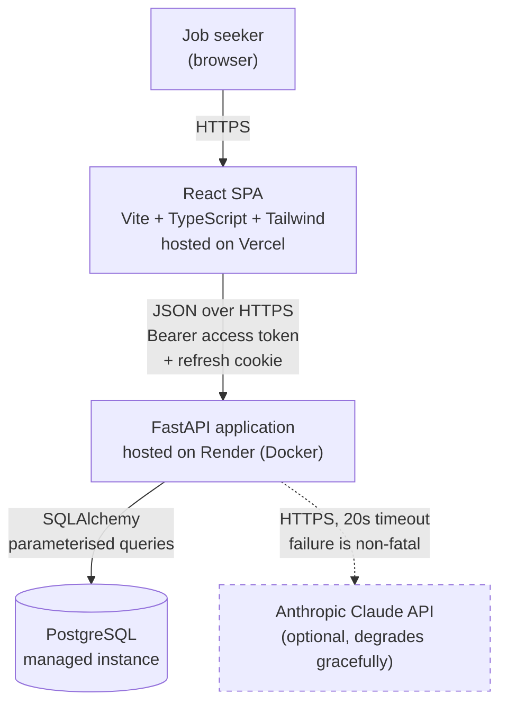
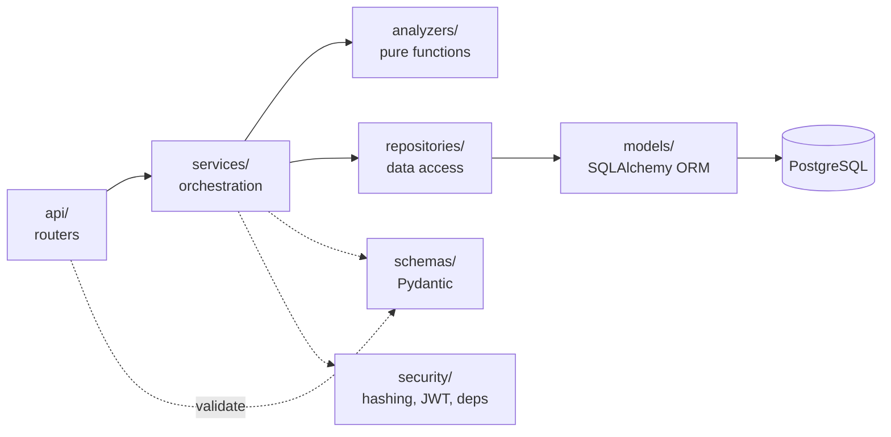
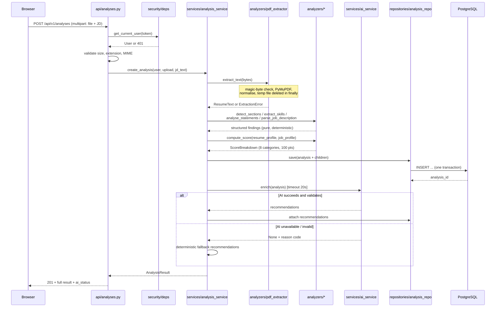
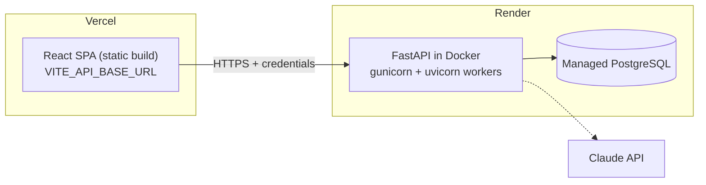

# ResumeIQ — System Architecture

> Phase 1 deliverable. Diagrams here are Mermaid so they render on GitHub and can be
> exported as images for the README in Phase 15.

---

## 1. Architectural style

A **modular monolith**: one FastAPI application with clear internal layers, one React SPA,
one PostgreSQL database.

Microservices, message queues, and background workers were considered and rejected. At the
expected volume (tens of analyses per user), the deterministic analysis completes in under
two seconds inside the request. Adding a broker would introduce infrastructure the project
cannot justify and cannot demonstrate value from. **The layers exist where they earn their
keep; nowhere else.**

The one place asynchrony *is* used is the AI call — not for scale, but for isolation: the
deterministic result is computed and is returned regardless of what the AI provider does.

---

## 2. System context



The dashed edge is the point of the design: **the AI provider is the only external
dependency, and the system is fully functional without it.**

---

## 3. Backend layers



| Layer | Responsibility | Must not |
|---|---|---|
| `api/` | HTTP concerns only: routing, status codes, dependency injection, request/response schemas | Contain business logic or touch the ORM session directly |
| `schemas/` | Pydantic request and response models; the API contract in code | Contain SQLAlchemy models |
| `services/` | Orchestration — sequence the analyzers, assemble the result, persist it, call the AI layer | Know about `Request`, `Response`, or HTTP status codes |
| `analyzers/` | **Pure functions.** Text in, structured data out. No I/O, no database, no clock, no network | Import anything from `api/`, `models/`, or `repositories/` |
| `repositories/` | All database queries. Every analysis query takes `owner_id` as a mandatory argument | Contain scoring or parsing logic |
| `models/` | SQLAlchemy table definitions and relationships | Contain query logic |
| `security/` | Password hashing, JWT encode/decode, `get_current_user` dependency, rate limiting | — |
| `core/` | Settings (`pydantic-settings`), logging config, custom exception types, error codes | Import from `api/` or `services/` |
| `utilities/` | Filename sanitisation, text normalisation, small shared helpers | Grow into a dumping ground |

**Why `analyzers/` is separated from `services/`:** the analyzers are the intellectual core
of the project and the part most worth testing. Keeping them pure means every scoring rule
is unit-testable with a plain string and no fixtures, no database, and no mocking. This is
also the layer to walk an interviewer through.

**Why `repositories/` exists at all:** ownership enforcement lives in one place. If the
`owner_id` filter is in the query function rather than in each route, a forgotten check in a
new route is impossible rather than merely unlikely.

---

## 4. Request flow — creating an analysis



Two properties of this flow matter and should be stated in the README:

1. **The analysis is persisted before the AI call.** If the AI provider hangs or fails, the
   user's result already exists.
2. **No branch of this flow writes the PDF to durable storage.** The bytes live in memory or
   in a temp file removed in a `finally` block, and are gone before the response is sent.

---

## 5. Frontend architecture

```
src/
├── api/          axios instance, interceptors, one module per resource
├── components/   generic, reusable, feature-agnostic (Button, Card, Modal, Badge…)
├── features/     feature-scoped components + hooks (auth/, analysis/, dashboard/)
├── hooks/        cross-feature hooks (useAuth, useDebounce, useMediaQuery)
├── layouts/      PublicLayout, AppLayout (sidebar), PrintLayout
├── pages/        one component per route, composed from features + components
├── routes/       route table, ProtectedRoute, lazy boundaries
├── schemas/      Zod schemas — shared by React Hook Form and by API response parsing
├── services/     token storage, report export, formatting
├── types/        TypeScript types mirroring the API contract
└── utilities/    pure helpers (score colour bands, date formatting, text truncation)
```

**`components/` vs `features/`:** if it could be lifted into another project unchanged, it
belongs in `components/`. If it knows what a "match score" is, it belongs in `features/`.

**Server state:** React Query (TanStack Query) for fetching, caching, and invalidation.
Client state (auth user, theme, modal open/closed) uses React Context — there is not enough
of it to justify a store library. Confirm this in Phase 2.

**Auth token handling:** the access token lives in a module-scoped variable inside
`services/tokenStore.ts` and in React context — never in `localStorage`. An axios response
interceptor catches a single 401, attempts one refresh against the `httpOnly` cookie, and
retries the original request; a second failure clears state and redirects to login. This is
decision **D1** in `01-requirements.md`.

---

## 6. Data flow — what crosses each boundary

| Boundary | Carries | Deliberately does **not** carry |
|---|---|---|
| Browser → API | PDF bytes, JD text, access token | — |
| API → analyzers | Normalised plain text | The uploaded file, the user identity |
| API → PostgreSQL | Score breakdown, skill lists, section results, flagged bullet strings, JD text, recommendations | The PDF, full resume text (unless explicitly opted in), the password |
| API → Claude API | A bounded, structured summary: matched/missing skills, flagged bullets, section gaps, JD title | Name, email, phone, employer names, or the full resume text |
| API → logs | Request ID, route, status, duration, error code, user ID | Resume text, JD text, email addresses, tokens, PDF filenames |
| API → Browser | Result payload + `ai_status` + disclaimer | Stack traces, file paths, SQL, library names |

The API → AI row is a privacy design decision, not an afterthought: the prompt is assembled
from *derived findings*, so a third party never receives a full résumé. This is stated on the
privacy page.

---

## 7. Error handling architecture

One custom exception hierarchy in `core/exceptions.py`, one global exception handler in
`main.py`. Every error the user can see has a stable machine code and a three-part message.

```python
# shape, not final code
class AppError(Exception):
    code: str            # "RESUME_NO_TEXT_LAYER"
    http_status: int     # 422
    what: str            # "We could not read any text from this PDF."
    why: str             # "It looks like a scan or an exported image."
    next_step: str       # "Export a text-based PDF from Word or Google Docs and retry."
```

The handler returns:

```json
{
  "error": {
    "code": "RESUME_NO_TEXT_LAYER",
    "what": "...", "why": "...", "next_step": "...",
    "request_id": "b3f1c2..."
  }
}
```

Unhandled exceptions return a generic `INTERNAL_ERROR` body with the request ID only; the
detail is logged server-side against that ID. This satisfies NFR-7 and gives support a
traceable handle without leaking internals.

---

## 8. Technology decisions and rationale

| Choice | Why this, over the alternative |
|---|---|
| **FastAPI** | Pydantic validation is the same object that generates OpenAPI docs — the API contract cannot drift from the code. Native async for the AI call. |
| **PyMuPDF** | Fastest and most accurate text extraction of the pure-Python options; handles multi-column layouts better than PyPDF2. Licence (AGPL) is acceptable for an open-source portfolio project — **note this in the README**. |
| **PostgreSQL** | Real foreign keys, `ON DELETE CASCADE`, and JSONB for the semi-structured evidence blobs. SQLite would not demonstrate migration or constraint work. |
| **Alembic** | Schema changes are reviewable artefacts in git rather than manual DDL. |
| **bcrypt via passlib** | Deliberately slow, salted per password, industry standard. Not SHA-256. |
| **JWT (HS256)** | Stateless access tokens suit a two-service deployment. Refresh tokens are stored server-side so logout can actually revoke. |
| **React + TypeScript + Vite** | `strict` TypeScript catches contract drift between frontend types and API responses at build time. |
| **Tailwind CSS** | Design tokens live in `tailwind.config.ts`, which makes "one consistent design system" enforceable rather than aspirational. |
| **React Hook Form + Zod** | One schema powers validation, TypeScript types, and error messages. The same rules are re-implemented in Pydantic server-side because client validation is UX, not security. |
| **Recharts** | Composable React components, accessible defaults, small enough for a single chart. |
| **Anthropic Claude API (`claude-opus-5`)** | Strong instruction-following for the "never fabricate" constraint, and structured-output support so responses can be schema-validated. Model ID is an environment variable, so it is swappable. |
| **Docker Compose** | One command reproduces API + DB + frontend from a clean clone (NFR-14). |

---

## 9. Deployment topology



- CORS on the API allows exactly the Vercel production origin plus `http://localhost:5173`,
  with `allow_credentials=True`. Never `*` (NFR-6).
- Refresh cookie: `httpOnly; Secure; SameSite=None` — required because the frontend and API
  are on different registrable domains.
- Alembic migrations run as a release command on deploy, not on application start, so two
  concurrent workers cannot race.
- Free-tier instances sleep; the README will state the ~30 s cold-start honestly.

---

## 10. Repository layout

```
Ai Resume Analyzer/
├── README.md
├── LICENSE
├── .gitignore
├── docker-compose.yml
├── docs/                      ← Phase 1 planning documents (this folder)
│   ├── 01-requirements.md
│   ├── 02-user-stories.md
│   ├── 03-architecture.md
│   ├── 04-database-design.md
│   ├── 05-api-contract.md
│   ├── 06-scoring-methodology.md
│   ├── 07-security-privacy.md
│   ├── 08-testing-strategy.md
│   └── 09-project-plan.md
├── backend/
│   ├── app/
│   │   ├── api/v1/            auth.py, analyses.py, users.py, health.py
│   │   ├── core/              config.py, logging.py, exceptions.py, error_codes.py
│   │   ├── database/          session.py, base.py
│   │   ├── models/            user.py, analysis.py, score.py, skill_match.py, ...
│   │   ├── schemas/           auth.py, analysis.py, common.py
│   │   ├── repositories/      user_repo.py, analysis_repo.py
│   │   ├── services/          auth_service.py, analysis_service.py, ai_service.py
│   │   ├── analyzers/         pdf_extractor.py, section_detector.py,
│   │   │                      skill_extractor.py, jd_parser.py,
│   │   │                      statement_analyzer.py, scorer.py
│   │   ├── data/              skills_taxonomy.json, action_verbs.json, stopwords.json
│   │   ├── security/          password.py, tokens.py, dependencies.py, rate_limit.py
│   │   ├── utilities/         text.py, files.py
│   │   └── main.py
│   ├── tests/                 unit/, integration/, fixtures/
│   ├── alembic/
│   ├── requirements.txt
│   ├── .env.example
│   └── Dockerfile
└── frontend/
    ├── src/                   (see §5)
    ├── tests/
    ├── public/
    ├── .env.example
    └── Dockerfile
```

---

## 11. Known architectural limitations

Stated here so they can be copied verbatim into the README rather than discovered by a
reviewer.

1. **Skill matching is lexical, not semantic.** A resume saying "built REST endpoints in
   Flask" will not match a JD asking for "API development" unless both terms are in the
   taxonomy. Embedding-based matching is a future improvement, deliberately deferred because
   it would make the score non-explainable.
2. **The taxonomy is finite.** Roughly 300 curated skills. Niche or brand-new technologies
   will be missed, which understates the score. The UI must not present the score as complete
   truth.
3. **Required/preferred classification is cue-based.** Job descriptions that do not use
   conventional headings fall back to "all required", which can depress the score. The
   analysis discloses when this fallback was used.
4. **Synchronous analysis.** A very large PDF on a cold free-tier instance may approach the
   platform request timeout. Acceptable at this scale; a background job queue is the
   documented scaling path.
5. **No OCR.** Scanned resumes are detected and explained, not processed.
6. **Single-region deployment.** No redundancy or failover; this is a portfolio project, not
   a production service, and the README says so.
