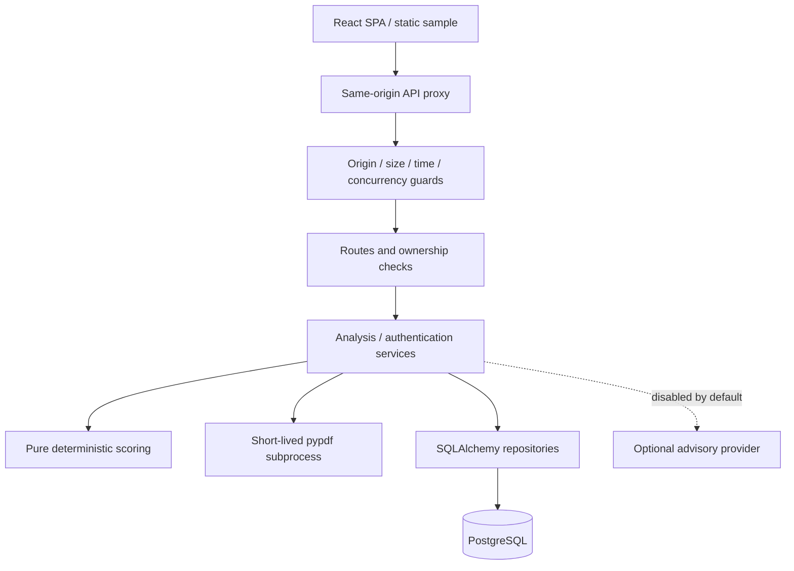

# Architecture

Release design, 15 October 2026. Hosting remains proposed until the [account and live checks](10-release-readiness.md) pass.

## Boundaries

A modular FastAPI monolith owns authentication, analysis and persistence. React uses TanStack Query for server state and a memory-only access token. The default API base is `/api/v1`; Vite proxies locally and Vercel rewrites to the verified Render service. This keeps the refresh cookie on the frontend host instead of relying on third-party cookies.

Routes validate inputs and ownership; services orchestrate; repositories scope queries to users. Domain analyzers are pure functions with an explicit reference-date option. Pydantic defines contracts; Alembic applies forward schema changes before serving production traffic.

## Upload lifecycle

1. Authenticate and validate exact Origin; atomically consume quota before expensive work.
2. Bound the request before multipart parsing: 5 MB plus 64 KB overhead, four mutation slots and a 20-second receive deadline.
3. Check PDF name/media type/magic bytes and metadata lengths. Close the upload after reading. Temporary multipart spooling may occur.
4. Offload analysis from the event loop. One child receives PDF bytes and a minimal environment without application credentials. The parent bounds elapsed time; Linux bounds child memory/CPU; the child bounds pages and text.
5. Extract and normalize skills, dates, sections, statements and job requirements; calculate the published rubric and recommendations.
6. Persist report children transactionally. A user-scoped UUID idempotency key returns an already saved result on retry.
7. AI remains off for RM0. If explicitly enabled elsewhere, send only structured derived findings, validate bounded output and append labelled advice. AI never changes the score.

## Persistence and sessions

Nine application tables store users, refresh-token hashes and reports/findings. Default reports include evidence snippets and job descriptions; PDF bytes are not stored and full extracted text requires opt-in.

Refresh redemption locks the user row and conditionally consumes one token in the replacement transaction. Password changes/deletion share that lock. JWT session versions are checked against the user and invalidate older access tokens after a password change.

## Operations

Use one Uvicorn worker: quotas and the PDF semaphore are process-local. Runtime pooling is two connections plus two overflow. Migrations use a direct Neon connection, independently verified host/database, a session advisory lock, and refusal of unversioned nonempty databases. Never downgrade production or seed a public account.

The static fictional sample remains viewable when the API sleeps. The app may attempt session restoration, but sample mode does not fetch private reports or offer AI mutations. An unchanged upload retry retains its idempotency key; reload can lose it, so timeout guidance says to check History first.

Render cold starts and quota suspension affect availability. Proxy peers can share rate quotas; restart resets them. Distributed protection, email recovery, OCR and availability guarantees are outside this release.
