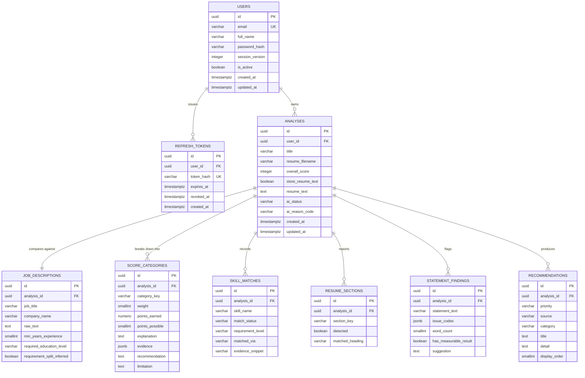

# ResumeIQ — Database Design

> Phase 1 deliverable. Implemented in Phase 3 (users) and Phase 9 (analysis tables) via
> Alembic migrations.

---

## Release implementation notes — 15 October 2026

There are **nine application tables**: users, refresh_tokens, analyses, job_descriptions, score_categories, skill_matches, resume_sections, statement_findings and recommendations. Alembic adds its own version table. Email is normalized by application validation and stored as VARCHAR, not CITEXT.

Migration `0004_release_safety` adds `users.session_version` (non-null integer, default zero) and nullable `analyses.request_key` (36-character UUID string), unique with user_id. Password changes increment the version to invalidate old access JWTs. The idempotency key makes repeated uploads return one owned report. Refresh consumption/password changes lock the user row to serialize session mutations. Full extracted text is opt-in; evidence excerpts remain stored by default.

The original schema design below remains useful for relationships; actual SQLAlchemy models and migrations are authoritative for exact types and indexes. PostgreSQL 16 CI now exercises migrations and the API suite; deployed Neon identity/state must be independently verified.

## 1. Entity relationship diagram



---

## 2. Table specifications

### `users`

| Column | Type | Constraints | Notes |
|---|---|---|---|
| `id` | `UUID` | PK, default `gen_random_uuid()` | UUID not serial, so IDs are not enumerable |
| `email` | `CITEXT` | NOT NULL, UNIQUE | `CITEXT` gives case-insensitive uniqueness at the database level rather than relying on application normalisation |
| `full_name` | `VARCHAR(120)` | NOT NULL | |
| `password_hash` | `VARCHAR(255)` | NOT NULL | bcrypt output. **Never selected into any response schema** |
| `is_active` | `BOOLEAN` | NOT NULL, default `true` | Allows disabling without deleting |
| `created_at` | `TIMESTAMPTZ` | NOT NULL, default `now()` | |
| `updated_at` | `TIMESTAMPTZ` | NOT NULL, default `now()` | Updated via ORM `onupdate` |

Index: `ix_users_email` is implicit in the UNIQUE constraint.
`CHECK (char_length(full_name) BETWEEN 1 AND 120)`.

### `refresh_tokens`

| Column | Type | Constraints | Notes |
|---|---|---|---|
| `id` | `UUID` | PK | |
| `user_id` | `UUID` | FK → `users.id` **ON DELETE CASCADE**, NOT NULL | |
| `token_hash` | `VARCHAR(255)` | NOT NULL, UNIQUE | **SHA-256 of the token, not the token.** A database leak must not yield usable sessions |
| `expires_at` | `TIMESTAMPTZ` | NOT NULL | |
| `revoked_at` | `TIMESTAMPTZ` | NULL | Set on logout; a non-null value invalidates the token |
| `created_at` | `TIMESTAMPTZ` | NOT NULL, default `now()` | |

Index: `ix_refresh_tokens_user_id`. Expired rows are pruned on login.

### `analyses`

The aggregate root. Everything else in the analysis domain hangs off this row.

| Column | Type | Constraints | Notes |
|---|---|---|---|
| `id` | `UUID` | PK | |
| `user_id` | `UUID` | FK → `users.id` **ON DELETE CASCADE**, NOT NULL | Ownership. Every query filters on this |
| `title` | `VARCHAR(120)` | NOT NULL | User-editable; defaults to the job title or the date |
| `resume_filename` | `VARCHAR(255)` | NOT NULL | Sanitised display label only — never a path |
| `overall_score` | `SMALLINT` | NOT NULL, `CHECK (0..100)` | Denormalised from `score_categories` so list and dashboard queries need no join |
| `store_resume_text` | `BOOLEAN` | NOT NULL, default `false` | The user's per-analysis retention choice (FR-G2) |
| `resume_text` | `TEXT` | NULL | Populated **only** when `store_resume_text` is true. `CHECK (store_resume_text OR resume_text IS NULL)` enforces this in the database, not just in code |
| `ai_status` | `VARCHAR(20)` | NOT NULL, default `'unavailable'` | `available` \| `unavailable` |
| `ai_reason_code` | `VARCHAR(40)` | NULL | `not_configured` \| `timeout` \| `rate_limited` \| `provider_error` \| `invalid_output` \| `quota_exceeded` |
| `created_at` / `updated_at` | `TIMESTAMPTZ` | NOT NULL | |

Indexes:
- `ix_analyses_user_created` on `(user_id, created_at DESC)` — serves the history list and the
  dashboard trend chart in one index.
- `ix_analyses_user_id` is covered by the composite above.

The `CHECK (store_resume_text OR resume_text IS NULL)` constraint is worth highlighting in an
interview: the privacy guarantee is enforced by the schema, so a future code path cannot
quietly violate it.

### `job_descriptions`

One-to-one with `analyses` (kept separate to keep the root row narrow and the JD text
independently deletable).

| Column | Type | Constraints |
|---|---|---|
| `id` | `UUID` | PK |
| `analysis_id` | `UUID` | FK → `analyses.id` ON DELETE CASCADE, NOT NULL, **UNIQUE** |
| `job_title` | `VARCHAR(160)` | NULL |
| `company_name` | `VARCHAR(160)` | NULL |
| `raw_text` | `TEXT` | NOT NULL, `CHECK (char_length BETWEEN 200 AND 8000)` |
| `min_years_experience` | `SMALLINT` | NULL, `CHECK (>= 0)` |
| `required_education_level` | `VARCHAR(20)` | NULL — `none`\|`certificate`\|`diploma`\|`bachelor`\|`master`\|`doctorate` |
| `requirement_split_inferred` | `BOOLEAN` | NOT NULL, default `false` — true when the required/preferred fallback was used (FR-D3) |

JD text is stored in full: it is public employer content, not the user's personal data.

### `score_categories`

| Column | Type | Constraints |
|---|---|---|
| `id` | `UUID` | PK |
| `analysis_id` | `UUID` | FK ON DELETE CASCADE, NOT NULL |
| `category_key` | `VARCHAR(40)` | NOT NULL — one of the eight keys in `06-scoring-methodology.md` |
| `weight` | `SMALLINT` | NOT NULL, `CHECK (0..100)` |
| `points_earned` | `NUMERIC(5,2)` | NOT NULL, `CHECK (>= 0)` |
| `points_possible` | `SMALLINT` | NOT NULL, `CHECK (>= 0)` |
| `explanation` | `TEXT` | NOT NULL |
| `evidence` | `JSONB` | NOT NULL, default `'[]'` — the specific matches behind the points |
| `recommendation` | `TEXT` | NULL |
| `limitation` | `TEXT` | NOT NULL |

`UNIQUE (analysis_id, category_key)` — a category cannot be scored twice.
`CHECK (points_earned <= points_possible)`.

`evidence` is JSONB rather than a further table: its shape differs per category, it is only
ever read as a whole, and it is never queried by its internal fields. This is a considered
use of JSONB, not a way to avoid designing a schema.

### `skill_matches`

| Column | Type | Constraints |
|---|---|---|
| `id` | `UUID` | PK |
| `analysis_id` | `UUID` | FK ON DELETE CASCADE, NOT NULL |
| `skill_name` | `VARCHAR(80)` | NOT NULL — canonical taxonomy name |
| `match_status` | `VARCHAR(12)` | NOT NULL — `matched` \| `partial` \| `missing` |
| `requirement_level` | `VARCHAR(12)` | NOT NULL — `required` \| `preferred` |
| `matched_via` | `VARCHAR(16)` | NULL — `exact` \| `alias` \| `related`; null when missing |
| `evidence_snippet` | `VARCHAR(240)` | NULL — the resume fragment where it was found |

`UNIQUE (analysis_id, skill_name)`.
Index `ix_skill_matches_status` on `(analysis_id, match_status)` — powers the dashboard's
"most common missing skills" aggregate.

`evidence_snippet` is capped at 240 characters. It is the only resume-derived text stored
outside the opt-in field, and it exists because the results page must show *where* a skill
was found for the match to be credible.

### `resume_sections`

| Column | Type | Constraints |
|---|---|---|
| `id` | `UUID` | PK |
| `analysis_id` | `UUID` | FK ON DELETE CASCADE, NOT NULL |
| `section_key` | `VARCHAR(24)` | NOT NULL — `contact`, `summary`, `skills`, `experience`, `education`, `projects`, `certifications`, `achievements`, `languages` |
| `detected` | `BOOLEAN` | NOT NULL |
| `matched_heading` | `VARCHAR(120)` | NULL — the actual heading text that triggered detection |

`UNIQUE (analysis_id, section_key)`. Nine rows per analysis, always.

### `statement_findings`

| Column | Type | Constraints |
|---|---|---|
| `id` | `UUID` | PK |
| `analysis_id` | `UUID` | FK ON DELETE CASCADE, NOT NULL |
| `statement_text` | `VARCHAR(600)` | NOT NULL — the flagged bullet, truncated |
| `issue_codes` | `JSONB` | NOT NULL — e.g. `["NO_ACTION_VERB","NO_METRIC","GENERIC_PHRASING"]` |
| `word_count` | `SMALLINT` | NOT NULL |
| `has_measurable_result` | `BOOLEAN` | NOT NULL |
| `suggestion` | `TEXT` | NULL — structural or AI-generated rewrite |

Capped at 30 rows per analysis, enforced in the service layer. This is the bounded storage
described in FR-G2: only bullets the user needs to see again are kept.

### `recommendations`

| Column | Type | Constraints |
|---|---|---|
| `id` | `UUID` | PK |
| `analysis_id` | `UUID` | FK ON DELETE CASCADE, NOT NULL |
| `priority` | `VARCHAR(8)` | NOT NULL — `high` \| `medium` \| `low` |
| `source` | `VARCHAR(16)` | NOT NULL — `rule` \| `ai` |
| `category` | `VARCHAR(32)` | NOT NULL — `skills` \| `sections` \| `statements` \| `experience` \| `interview` |
| `title` | `VARCHAR(160)` | NOT NULL |
| `detail` | `TEXT` | NOT NULL |
| `display_order` | `SMALLINT` | NOT NULL |

The `source` column is deliberate: the UI labels which suggestions came from the rule engine
and which from the AI, so the user always knows what they are reading. It also makes the
"works without AI" behaviour visible rather than silent.

---

## 3. Design decisions

**UUID primary keys.** Sequential integers make record counts and other users' rows guessable.
Combined with the 404-not-403 ownership rule (FR-G3), UUIDs mean an attacker cannot even
confirm that an ID exists.

**`ON DELETE CASCADE` everywhere below `users`.** Account deletion (US-4) must be complete,
and orphaned analysis rows would be a privacy failure. The cascade is declared in the schema,
so it holds even for direct SQL.

**Denormalised `overall_score` on `analyses`.** The history list and dashboard read it on
every page load; recomputing from eight child rows per analysis would turn a simple list into
an aggregate query. The value is written once, in the same transaction as its categories, and
never mutated — the classic safe case for denormalisation.

**No `resumes` table and no file storage.** There is nowhere in this schema to put a PDF. That
is the point.

**Timestamps are `TIMESTAMPTZ`.** Users and servers are in different timezones; naive
timestamps produce off-by-hours bugs in the trend chart.

**Nine section rows always written, including `detected = false`.** Storing absence explicitly
means "was this analysed and found missing?" and "was this never analysed?" are
distinguishable — important when the analyser is extended later.

---

## 4. Migration plan

| Migration | Phase | Contents |
|---|---|---|
| `0001_enable_extensions` | 3 | `CREATE EXTENSION IF NOT EXISTS pgcrypto, citext` |
| `0002_create_users` | 3 | `users` |
| `0003_create_refresh_tokens` | 4 | `refresh_tokens` |
| `0004_create_analyses_core` | 9 | `analyses`, `job_descriptions` |
| `0005_create_analysis_children` | 9 | `score_categories`, `skill_matches`, `resume_sections`, `statement_findings` |
| `0006_create_recommendations` | 9/11 | `recommendations` |

Rules: every migration has a working `downgrade()`; migrations are never edited after being
pushed — a correction is a new migration; `alembic upgrade head` runs as a deploy release
command, never at application start-up (two workers would race).

---

## 5. Representative queries

```sql
-- History list (uses ix_analyses_user_created; no join needed)
SELECT id, title, overall_score, created_at
FROM analyses
WHERE user_id = :user_id
ORDER BY created_at DESC
LIMIT 10 OFFSET :offset;

-- Ownership-safe fetch: filter, never fetch-then-check
SELECT * FROM analyses WHERE id = :analysis_id AND user_id = :user_id;

-- Dashboard: most common missing required skills
SELECT sm.skill_name, COUNT(*) AS occurrences
FROM skill_matches sm
JOIN analyses a ON a.id = sm.analysis_id
WHERE a.user_id = :user_id
  AND sm.match_status = 'missing'
  AND sm.requirement_level = 'required'
GROUP BY sm.skill_name
ORDER BY occurrences DESC
LIMIT 8;
```

Every one of these is expressed in SQLAlchemy with bound parameters. There is no string
interpolation into SQL anywhere in the project (NFR-5).
